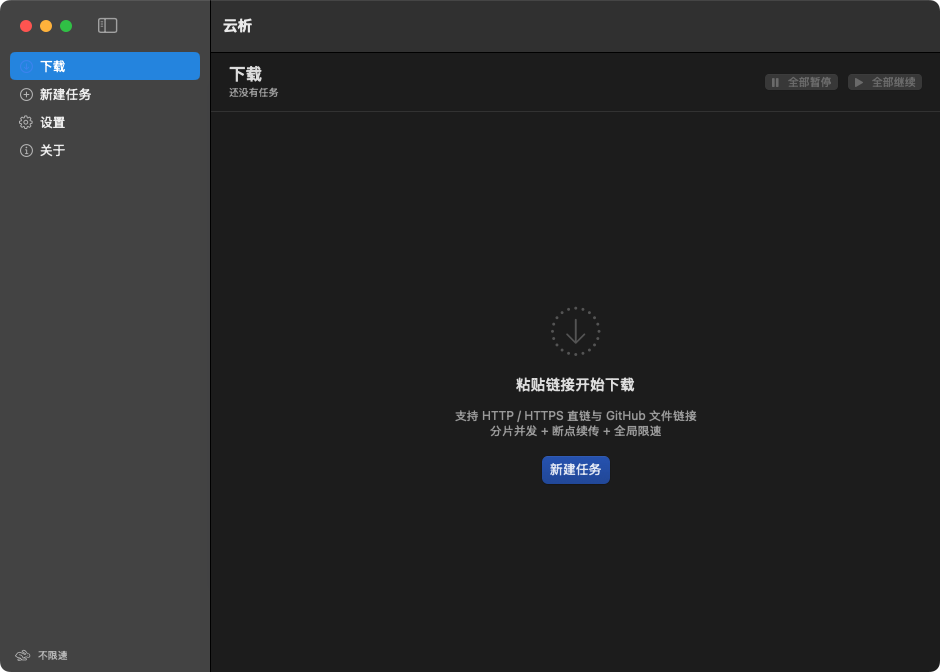

# 云析 · 跨平台版（macOS / Linux）

> 粘贴链接，直接高速下载 —— 参考 [YunX-Desktop](https://github.com/tidain/YunX-Desktop) 的设计，提供 macOS 与 Linux 双平台客户端。

**macOS 版**：Swift + SwiftUI 原生重写，通用二进制，**Apple 芯片（arm64）与 Intel 芯片（x86_64）同包原生运行**，单个 DMG 1.3 MB。

**Linux 版**：见 [linux/README.md](linux/README.md)，纯 Python 标准库实现，带命令行与本地网页面板，支持百度分享与直链，16 项自动化测试全部通过。



---

## 这是什么

原项目 [YunX-Desktop](https://github.com/tidain/YunX-Desktop) 是基于 Kotlin + Compose Multiplatform 的 **Windows** 桌面端，深度绑定 Windows 运行时（JNA 调 Win32、`darkmode.dll`、JCEF Windows 原生库、Inno Setup 打包）。

本项目不是简单的「改个构建目标」，而是用 Swift + SwiftUI **从零重写** 一个 macOS 原生实现，保留核心的下载能力与交互形态，去掉所有 Windows 依赖：

| | YunX-Desktop | 本项目 |
|---|---|---|
| 语言 / UI | Kotlin + Compose Multiplatform | Swift + SwiftUI |
| 运行时 | JVM + jlink + jpackage | 无运行时，原生二进制 |
| 安装包 | Inno Setup（.exe） | DMG（拖拽安装） |
| 体积 | 100 MB+（含 JRE / CEF） | 1.3 MB |
| 架构 | Windows x64 | arm64 + x86_64 通用 |

## 功能现状

### 已实现并已验证

| 能力 | 说明 |
|---|---|
| **分片并发下载** | 单任务多连接 Range 并行。40 MB 测试文件 8 分片，实测 ~17 MB/s |
| **断点续传** | 每个分片的已落盘字节实时记录，退出应用、重启后仍从断点续传（实测 16 MB 处暂停 → 恢复 → SHA-256 与原文件完全一致） |
| **断线自动重试** | 连接中断、超时、服务器 5xx 时自动重连，每次都从断点接着下，不需要人守着点「继续」。实测极端弱网（服务器每 60 KB 必断一次，累计 35 次断连）仍能完整下完 2 MB 并逐字节校验通过，用时 17.3 s。断网恢复与唤醒电脑会立刻重试；403 / 404 / 链接过期这类重试无用的错误直接报失败 |
| **扛住网盘限流** | 网盘限流时会回 `206` 但 body 为 0 字节，不再被当成失败消耗重试次数：空响应单独计数、退避 30–180 秒、自动把并发压到串行、新建连接间隔 0.4 秒。实测 34 MB 百度直链完整下完并校验通过 |
| **全局限速** | 基于「时间片预约」的精确限速，多任务共享总带宽，不会按任务叠加。实测 2 MB/s 档位 40 MB 用时 17.9 s（理论 19.1 s） |
| **链接识别** | 本地规则识别夸克 / UC / 百度 / 蓝奏云 / 123 / 115 / 迅雷 / 139 / 阿里云盘、B 站 / 抖音 / 小红书 / 微博 / 快手 / AcFun / Pixiv、GitHub、磁力 / eD2k / BT 种子、HTTP 直链；自动提取 `提取码 / 密码 / pwd` |
| **GitHub 镜像测速** | 并发实测各 gh-proxy 镜像的握手延迟与真实吞吐，自动选最快；支持固定某个或自定义前缀 |
| **多任务队列** | 可配置同时下载任务数，排队自动放行 |
| **任务持久化** | 任务列表与分片进度落盘到 `~/Library/Application Support/YunX-Mac-Desktop/tasks.json`，重启恢复 |
| **原生集成** | 系统通知、Finder 定位、拖拽链接进窗口、剪贴板识别、深浅色自适应 |
| **百度网盘直下** | 内置登录窗登一次，之后分享链接直接进下载队列。实测 259 MB 分享视频解析出真实直链，`HTTP 206` + `Content-Type: video/mp4`，支持分片并发。详见下方「百度网盘解析链路」 |

### 百度网盘解析链路

这条链路是逐层实测出来的，几个关键点记在这里，免得以后重复踩：

```
首页取 BAIDUID → /share/verify 验提取码换 BDCLND → /share/list 列文件
  → 搜索网盘是否已有同名同大小文件（有则复用，不重复写盘）
  → /share/transfer 转存到 /来自分享
  → /rest/2.0/xpan/file?method=filemetas&dlink=1 取直链
  → 带 Referer + Cookie + UA 分片下载
```

**为什么必须转存**：百度从 2020 年后收掉了「未转存文件直接给直链」的能力。`/api/sharedownload` 对着分享 fs_id 一律回 `errno 2`，只有**自己网盘里**的文件才给可用地址。这是平台限制，不是实现取舍。

**几个反直觉的坑**：

| 坑 | 表现 | 正解 |
|---|---|---|
| `URLComponents.query` 二次编码 | 拼出的 URL 里 `%5B` 变成 `%255B`，接口认不出 | 用 `percentEncodedQuery`，或直接用字符串初始化 URL |
| 分享短链的两种写法混用 | `/share/list` 要用去掉开头 `1` 的 ID，`/share/tplconfig` 要用带 `1` 的原样 ID，混了回 `errno 2` | 区分 `baiduSurl` 与 `baiduRawToken` |
| sign 接口换代 | `/api/gettemplatevariable` 已不再下发 sign，只回 timestamp/bdstoken | sign 改从 `/share/tplconfig` 取 |
| `gettemplatevariable` 对 fields 敏感 | 只请求 `["bdstoken"]` 回 `errno 2` | 必须连同 `sign`/`timestamp` 一起请求 |
| 直链接口选错 | `/api/filemetas?dlink=1` 对文件回 `errno 12 / info.errno 31021` | 用 `/rest/2.0/xpan/file?method=filemetas`，且**不要**带空的 `access_token=` |
| 转存报「文件已存在」 | `errno 2, show_msg: 文件已存在`，且不返回 fs_id | 先 `/api/search` 按文件名 + 大小匹配复用已有文件 |
| 登录窗抓到脏 cookie | 凭证里混进 `undefined=`，后续请求全挂 | 写入时过滤空名与 `undefined` |

### 尚未实现

- **夸克 / UC**：解析代码已按同一套 `sharepage/token → detail → download` 接口写好，登录与凭证管理也已接好，但**没有真机验证过**，所以不宣称可用。需要一个真实分享链接跑通后才敢标「已支持」。
- **视频平台**（B 站 / 抖音 / 小红书 / 微博 / 快手 / AcFun / Pixiv）：作品页需要登录态 + 签名算法，本版本只识别来源。
- **其余六家网盘**：同样只识别来源与提取码，一键带码在浏览器打开。
- **P2P**（磁力 / BT / eD2k）：仅识别，请交给专用工具（原项目也是把 P2P 交给 Gopeed 引擎）。

「解析」本身是留成可插拔扩展点的（见下方 `Resolver` 设计），补一家平台只需要新增一个 `PanResolver` 实现。


## 安装

两个平台的安装包放在**同一个 Release tag** 下，从 [Releases](https://github.com/CrassusX/YunX-CrossPlatform/releases/latest) 下载对应平台的包：

| 平台 | 安装包 | 说明 |
|---|---|---|
| macOS（Apple 芯片 + Intel 通用） | `YunX-Mac-Desktop-<版本>.dmg` | 打开后把 app 拖进「应用程序」 |
| Linux（Python 3.8+，x86_64 / arm64 通用） | `YunX-Linux-<版本>.tar.gz` + `.sha256` | 校验后解压，跑 `scripts/install.sh`，详见 [linux/README.md](linux/README.md) |

每个 tag 下同时提供这两个平台的包，版本号一致。发布历史里 `v1.4.0` 起为双平台统一发布；更早的 `linux-v1.0.0`、`v1.0.0`~`v1.3.0` 为单平台历史版本。

**macOS 注意**：应用使用 **ad-hoc 签名**（没有 Apple 开发者证书），首次打开会被 Gatekeeper 拦下，两种解法：

```bash
# 方式一：命令行去掉隔离标记（推荐）
xattr -dr com.apple.quarantine /Applications/YunX-Mac-Desktop.app

# 方式二：右键点 app → 打开 → 在弹窗里再点「打开」
```

## 从源码构建

要求：macOS 13+、Xcode（或 Command Line Tools，但**通用二进制必须装完整 Xcode**，因为 SPM 的多架构构建依赖 xcbuild）。

```bash
git clone https://github.com/CrassusX/YunX-CrossPlatform.git
cd YunX-CrossPlatform

# 一键产出 .app 与 .dmg（自动编译 arm64 + x86_64 并 lipo 合并）
./scripts/build-app.sh

# 只要 .app
./scripts/build-app.sh --no-dmg

# 开发时直接跑（单架构，快）
swift build --disable-sandbox && swift run --disable-sandbox
```

产物：

```
dist/YunX-Mac-Desktop.app            # 通用二进制 app
dist/YunX-Mac-Desktop-1.4.0.dmg      # 分发包
```

> `--disable-sandbox` 是因为 SPM 编译 manifest 时会调用 `sandbox-exec`，在部分受限环境下会失败；正常开发机上可以省略。

## 架构

```
Sources/YunXMac/
├── App/
│   └── YunXMacApp.swift        # @main、菜单命令、配色
├── Core/                       # 与 UI 完全解耦，可单独测试
│   ├── Models.swift            # Provider / SegmentState / DownloadRecord
│   ├── LinkParser.swift        # 链接抽取、来源识别、提取码解析（纯本地）
│   ├── Prober.swift            # 只取响应头的探针：长度、Range 支持、文件名
│   ├── SegmentedDownloader.swift # 分片下载引擎（核心）
│   ├── Throttle.swift          # 全局时间片预约限速器
│   ├── DownloadManager.swift   # 任务池：排队、暂停恢复、持久化
│   ├── MirrorTester.swift      # 镜像延迟 + 吞吐实测
│   ├── AppSettings.swift       # UserDefaults 持久化设置
│   └── Notifier.swift          # 系统通知
└── UI/                         # SwiftUI 视图，只读 Manager 状态
```

### 下载引擎的四个关键决策

**1. 一个写线程独占所有写盘操作。**
网络回调（`URLSessionDataDelegate`）只把数据塞进内存缓冲队列；写盘、限速、重试调度全部在单条写线程里串行完成。分片写入是有序的，不会错位；同时写线程天然就是任务调度器。

**2. 背压而不是死扛。**
缓冲超过高水位（32 MB）就 `suspend()` 数据任务，降到低水位（8 MB）再 `resume()`。限速到 100 KB/s 时内存占用依然平稳，不会把整个文件堆进内存。

**3. 回调永不跑在写线程上。**
进度与完成回调统一走独立队列。否则调用方在 `onProgress` 里调 `pause()` 会等自己 → 死锁。（这个 bug 是在实现过程中真实踩到并修掉的。）

**4. 退避是时间戳，不是 sleep。**
写线程只有一个，如果在里面 `Thread.sleep` 做退避，一个分片睡 8 秒，其余七个分片就全都跟着干等，并发直接退化成串行。所以每个分片只记一个"最早可重连时刻"，写线程挑最近的时刻醒来。仅这一处改动就把极端弱网下的完成时间从 120 秒以上压到 17 秒。

配套的两条经验：**只要一次连接真的收到了数据，就把该分片的连续失败计数清零**（链路是通的，只是被掐断，不该背长退避）；**响应头是 5xx / 408 / 425 / 429 时同样走重试**，而不是像 403 / 404 那样直接判死。

**5. 把「空响应」当成独立的失败类型。**

这是接网盘直链之后才暴露出来的问题，也是最容易踩的坑：

网盘限流时不回 `429`，而是回一个 **`206 Partial Content` 但 body 长度为 0**。状态码完全正常，客户端看起来像"这段没数据"，实际上是在说"你现在请求太多"。

最初把它等同普通断线处理，后果是每收到一次空响应就消耗一次重试额度，30 次就判死。而一次限流往往持续几分钟，很容易把额度耗光。

现在的处理：
- **空响应单独计数**，不占 30 次重连额度（上限 80 次，收到数据即清零）
- 退避从 **30 秒**起步、最长 180 秒——限流按时间窗恢复，1 秒后重连只会再撞一次
- 连续空响应就**把并发放宽上限压到 1**，限流是按"单位时间请求数"算的，慢慢减半只是多触发几轮
- **新建连接之间强制间隔 0.4 秒**，把开局那一波打散到 2.5 个/秒以下，从源头避免踩线
- 有限流史的任务按每 4 MB 才放宽一条连接，避免刚恢复就冲回满格

实测同一百度直链：串行 8 次请求全返回空响应，静置 90 秒后单发 1.89 秒就能完整拿到——这就是判定"限流"而非"失效"的依据。

更多细节见 [docs/ARCHITECTURE.md](docs/ARCHITECTURE.md)。

### 扩展点：接网盘解析

新增一个平台不需要动 UI 和下载引擎，只要实现一个 resolver 把分享链接换成直链：

```swift
protocol Resolver {
    var provider: Provider { get }
    func resolve(link: ParsedLink) async throws -> ResolvedTarget
}

struct ResolvedTarget {
    var url: URL              // 可直链下载的地址
    var fileName: String
    var headers: [String: String]   // Cookie / Referer 等
}
```

拿到 `ResolvedTarget` 后交给 `DownloadManager.enqueue(...)`，分片、续传、限速全部复用。

## 目录里还有什么

```
scripts/make-icon.swift    # 用 CoreGraphics 直接按像素尺寸画图标，不缩放
scripts/build-app.sh       # 编译 → 组 .app → 签名 → 打包 DMG
.github/workflows/build.yml# CI：每次提交构建通用包，打 tag 自动发 Release
docs/ARCHITECTURE.md       # 引擎与队列设计细节
```

## 已知限制

- 网盘 / 视频平台私有解析未实现（见上文说明）。
- 服务器不支持 `Range` 时降级为单连接，此时「续传」等于重新下载。
- 未做公证（notarization），首次运行需手动绕过 Gatekeeper。
- 镜像测速结果是**当下**网络状况；镜像站点随时可能失效，可在设置里换。

## 与参考项目的关系

功能形态参考 [tidain/YunX-Desktop](https://github.com/tidain/YunX-Desktop)（与安卓版 [CYQawa/YunX](https://github.com/CYQawa/YunX) 同属云析项目）。本项目**没有复制其源码**，是用 Swift 独立实现，但设计思路与交互习惯受益于它，在此致谢。

云析项目坚持免费开源，任何收费版本都是二次打包的诈骗版本。本项目同样以 **AGPL-3.0** 开源。

## 许可证

[GNU AGPL-3.0](LICENSE)

仅供个人学习与合法用途。请遵守各平台服务条款，不要用于传播侵权内容。
